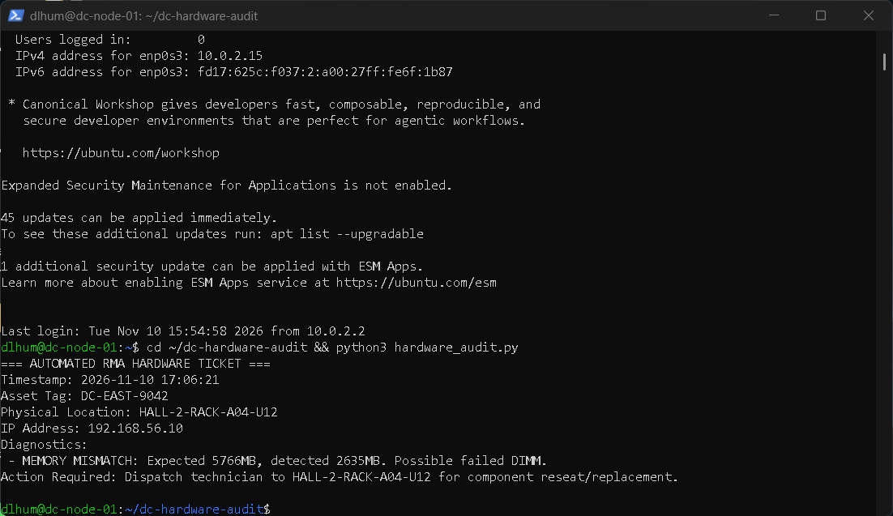
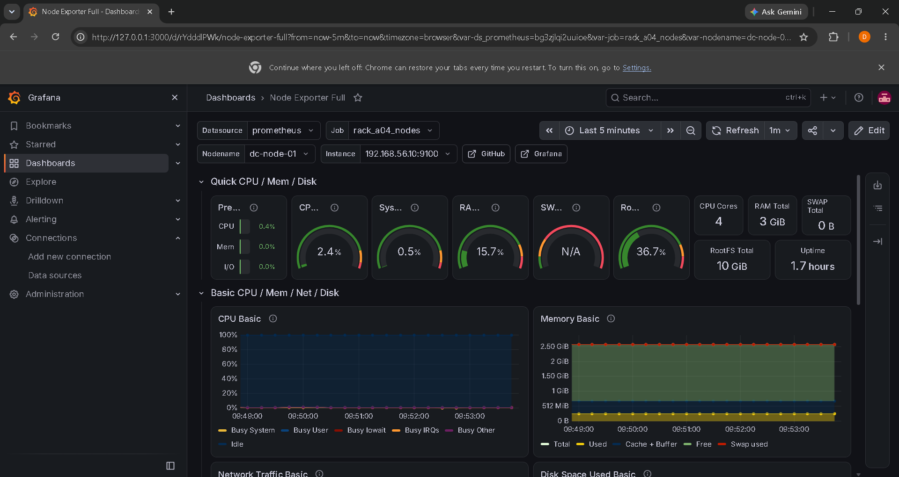

# Data Center Hardware Diagnostics & Telemetry Lab

An end-to-end virtualized data center rack simulation demonstrating automated bare-metal hardware auditing, Return Merchandise Authorization (RMA) dispatch ticket generation, and real-time Prometheus/Grafana telemetry monitoring.

## Architecture & Rack Elevation

The lab simulates a two-node Linux server deployment inside **Data Hall 2, Rack A04**, connected over an isolated Layer-2 management network (`192.168.56.0/24`).

```text
+-------------------------------------------------------------------+

|                     HALL-2 — RACK A04 (42U)                       |
+-----+-------------------------------------------------------------+

| U42 | [ Top-of-Rack (ToR) Management Switch — 192.168.56.0/24 ]   |
+-----+-------------------------------------------------------------+

| ... |                                                             |
+-----+-------------------------------------------------------------+

| U14 | [ dc-moniter-01 | 192.168.56.11 ]                           |
|     |   Role: Telemetry & Visualization Node (Prometheus/Grafana) |
+-----+-------------------------------------------------------------+

| U13 | [ Cable Management / Blank Panel ]                          |
+-----+-------------------------------------------------------------+

| U12 | [ dc-node-01 | Asset: DC-EAST-9042 | 192.168.56.10 ]        |
|     |   Role: Target Compute Node (Node Exporter + Audit Agent)   |
+-----+-------------------------------------------------------------+
```

## Key Components

* **`baseline.json`**: Asset inventory mapping logical network identifiers (`192.168.56.10`) to physical rack coordinates (`HALL-2-RACK-A04-U12`), asset tags (`DC-EAST-9042`), and expected hardware specifications (`5766 MB` RAM, `/dev/sda`).
* **`hardware_audit.py`**: Python diagnostic script that queries live kernel memory (`free -m`) and block storage devices (`lsblk`), compares them against `baseline.json`, and generates an actionable dispatch ticket (`rma_ticket.txt`) upon detecting hardware degradation.
* **Prometheus & Grafana Stack**: `prometheus-node-exporter` streams live CPU, memory, disk I/O, and network interface telemetry on port `9100` to `dc-moniter-01` for real-time visualization.

## Lab Evidence & Fault Simulation

### 1. Simulated DIMM Failure & Automated RMA Dispatch
To test fault detection, `dc-node-01` was powered down and its allocated memory was reduced from `6144 MB` to `3072 MB` to simulate a failed DIMM during POST/boot. Running `hardware_audit.py` flagged the discrepancy (`2635 MB` detected vs. `5766 MB` expected) and generated `rma_ticket.txt`.



### 2. Live Rack Telemetry Dashboard
Grafana (`Node Exporter Full` dashboard) scraping live hardware metrics from `dc-node-01` (`192.168.56.10:9100`) across the private management network.



## Skills Demonstrated
* **Linux Server Administration**: Ubuntu Server provisioning, static IPv4 configuration via Netplan, `systemd` service management, and `ufw` firewall rules.
* **Data Center Operations**: Asset tagging, rack U-elevation mapping, hardware baseline verification, and RMA dispatch workflows.
* **Infrastructure Monitoring & Scripting**: Python (`subprocess`, `json`), Prometheus scrape configuration, and Grafana dashboard deployment.
